  <h1>Olá! Eu sou Arliene 👋</h1>
  <h3>Desenvolvedora Web & Pesquisadora em Inteligência Artificial Generativa</h3>
  
Construindo soluções tecnológicas com impacto social e pesquisando inovações na Amazônia.

 

## 👩‍💻 Sobre mim

* 🎓 Mestra em Ciência da Computação, com pesquisa voltada à aplicação de Inteligência Artificial para grupos vulneráveis na região amazônica e ao desenvolvimento de soluções tecnológicas de apoio ao cuidado.
* 💻 Tenho grande interesse na interseção entre Inteligência Artificial, desenvolvimento de sistemas e impacto social, especialmente em como a tecnologia pode transformar a vida das pessoas.
* 🐱 Quando não estou codando, pesquisando ou escrevendo artigos, provavelmente estou ouvindo música ou na companhia dos meus dois gatos.
* 🎯 Foco atual: aprimoramento contínuo em ecossistemas React, integrações com Python, IA generativa, RAG e arquitetura de agentes conversacionais.

 

## 🛠️ Tecnologias e Ferramentas

  <table>
    <tr>
      <td></td>
      <td></td>
      <td></td>
      <td></td>
      <td></td>
      <td></td>
      <td></td>
    </tr>
  </table>

## 📊 Estatísticas do GitHub

  

 

## 📫 Vamos nos conectar!

  
  

